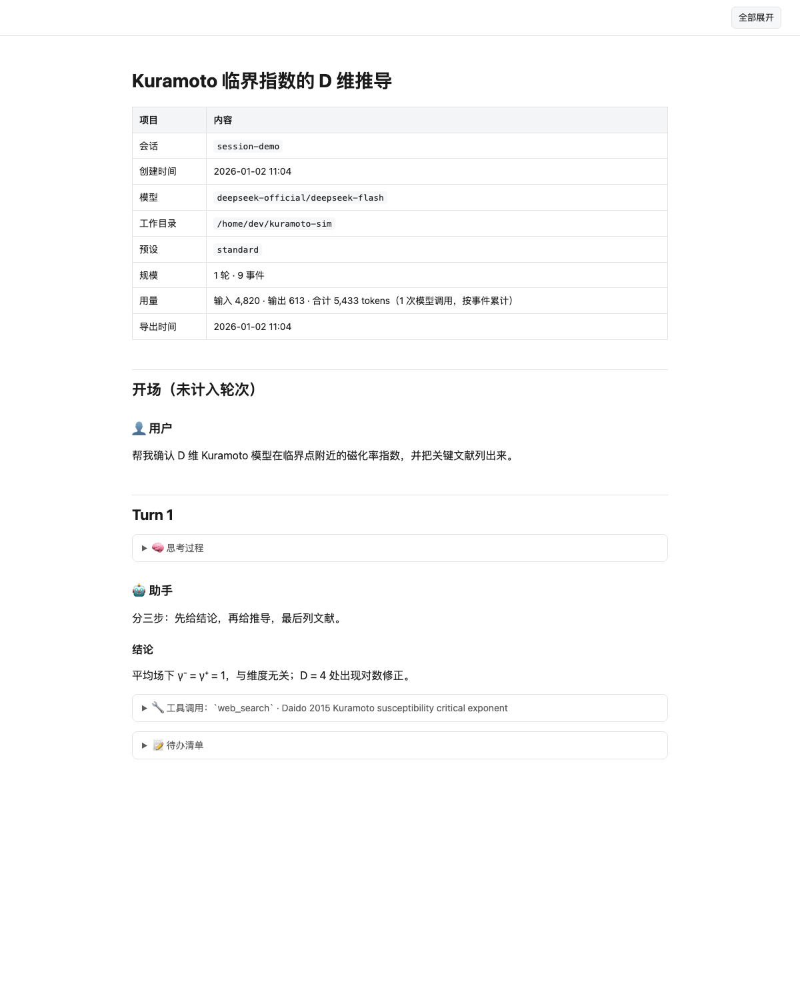

# dsh-session-md

[](https://github.com/QIN-SMART/dsh-session-md/actions/workflows/verify.yml)
[](LICENSE)

> A DeepSeek Harness plugin that exports a session as **human-readable Markdown or a self-contained HTML page** —
> grouped by turn: user messages, assistant replies, reasoning, tool calls with arguments and results, todos,
> compaction summaries and presented deliverables. The official `@deepseek-ai/dsh-session-log-export` only ships
> the raw JSONL log as a browser ZIP; this plugin fills the "one clean document per conversation" gap.

中文 → [README.md](README.md)



*Synthetic session rendered by `scripts/make-demo-screenshot.mjs` — no real conversation content.*

---

## Install

```sh
dsh plugin --profile web add github:QIN-SMART/dsh-session-md
```

The package declares `dsh.bundle.patch`, so `add` registers the loader entry for you — no manual `cordis.yml` edit.
**Refresh the browser page** and the export menu appears in the Session Header.

> After editing plugin source, a running host will not re-import the loaded module: restart `dsh web`.
> A page refresh only reloads the browser half.

Zero `@deepseek-ai/*` dependencies and zero `peerDependencies`, so the DSH compatibility gate
(`evaluatePluginCompatibility`) has nothing to refuse. Node `^22.19.0 || >=24`.

### All three platforms

Windows, macOS and Linux behave identically. Workspace writes go through `ctx.fs` (subject to the session sandbox);
browser downloads use an authenticated route and land wherever the browser puts them. File names always go through
`slugify`, which handles everything Windows forbids — `\ / : * ? " < > |`, control characters, a trailing dot or
space, and reserved device names such as `CON` / `NUL` / `COM1` — so an export never fails on a file name.
CI runs the same self-test matrix on ubuntu / windows / macos × Node 22/24.

## Usage

### One-click menu

The ⬇ button in the Session Header opens a mode menu:

| Menu entry | Download |
|---|---|
| Full (agent handoff / reproduction) | `mode=full` — tool arguments and results included |
| Handoff (tool calls kept, reasoning dropped) | `mode=handoff` — token-friendly |
| Readable (human, tool names only) | `mode=readable` — shortest |
| Audit (untruncated + system prompt + injected context) | `mode=audit` — for the record |
| Both (full + readable) | two files in a row |
| HTML · full / HTML · readable | `format=html` — self-contained, prints to PDF |

Downloads come from `GET|HEAD /api/session.export-md?sessionId=…&mode=…&format=md|html`. The Host sets
`Content-Disposition`, so file names (including non-ASCII titles) are correct.

### Let the model export (writes into the workspace)

```text
export_session_md({})                                # current session, mode full
export_session_md({ mode: 'readable' })              # human-friendly
export_session_md({ mode: 'both' })                  # full + readable side by side
export_session_md({ format: 'html' })                # self-contained HTML page
export_session_md({ all: true, path: '/abs/dir' })   # every session, with subagents
```

| Option | Default | Meaning |
|---|---|---|
| `mode` | `full` | `full` / `handoff` / `readable` / `audit` / `both` |
| `format` | `md` | `md` or `html` |
| `sessionId` | current | a stored (non-live) session works too |
| `all` | `false` | every session visible to the process |
| `path` | session cwd | a `.md`/`.html` file, or a directory |
| `includeSubagents` | `true` | write descendants under `<sessionId>.subagents/` |
| `includeToolDetails` / `includeReasoning` / `includeSystemPrompt` / `includeInjectedContext` | per mode | explicit values always override the preset |
| `maxToolResultChars` / `maxToolArgChars` / `maxReasoningChars` / `maxTextChars` | per mode | `0` means untruncated |

### Modes

| Mode | Tool calls | Reasoning | System prompt / injected context | Truncation |
|---|---|---|---|---|
| `full` | arguments + results | kept | no | args 4k / results 20k / reasoning 20k chars |
| `handoff` | arguments + results | **dropped** | no | args 1.5k / results 4k |
| `readable` | **names only** | kept (collapsed) | no | reasoning 6k |
| `audit` | arguments + results | kept | **both** | **none** |

## HTML export

`format: 'html'` (tool) and the two HTML menu entries (UI) produce **one self-contained file**: inline CSS, no
external requests at all, light/dark aware, with a "expand all" button. Print styles expand `<details>`, so
"print → Save as PDF" keeps reasoning and tool-call sections instead of printing empty summaries.

## Design notes

- **Content cannot break the document.** Conversation text containing `<details>` / `<summary>` is escaped,
  an unbalanced code fence is neutralized into literal backticks, and content headings are demoted so they never
  collide with the turn headings. Those three were found by sweeping 165 real session logs.
- **Markdown stays valid GFM.** The metadata block emits a header row and `| --- | --- |` delimiter; without the
  delimiter every Markdown reader (not just the HTML renderer) shows literal pipes.
- **Reads services, not files.** Session bodies come from `ctx.sessions` (live, flushed first) and
  `ctx.sessionPersistence` (stored), so a log-format change cannot break the exporter.
- **The browser route waits for its dependency.** `ctx.inject(['connection'], …)` instead of a one-shot
  `ctx.get('connection')`: in a real Web profile the connection service is provided after bundle plugins apply,
  and sampling it once silently registers nothing (the button then 404s).
- **Hot-pluggable by construction.** Registration is anchored to the plugin fiber, so unloading removes both the
  tool and the route; no module-level state, timers or listeners.

## Known limits

- Attachments are recorded as one explanatory line (`📎 image: shot.png, 20 KB, 718×160, sha256:…`); binary bytes are
  not copied. Use the official `/export` ZIP if you need the media.
- Exports written through `ctx.fs` stay inside the session workspace; that is the configured file policy, not a bug.
- No one-click PDF: print the HTML in the browser. Headless Chrome would work but needs per-platform discovery.

## Development

```sh
git clone https://github.com/QIN-SMART/dsh-session-md
cd dsh-session-md
node --test test/verify.mjs     # self test, zero dependencies, no DSH needed
npm run ci                     # the above + fixtures, browser half, real Cordis, real session sweep
npm run dump -- --list         # offline: render a stored session log to Markdown
dsh plugin --profile web add "link:$PWD"   # local development install
```

Agent-facing conventions live in [AGENTS.md](AGENTS.md).

## License

MIT
